# WhatsApp Privacy Blur — Architecture Design

| | |
|---|---|
| Status | Draft v1 — for review before `/sc:implement` |
| Source | `requirements.md` (§ numbers below refer to it) |
| Date | 2026-09-13 |
| Targets | macOS 14+ (tested through current release), arm64 first, Swift 6 strict concurrency |

---

## 0. Executive Summary

A background-only (`LSUIElement`) menu-bar app that:

1. Watches for WhatsApp through **NSWorkspace** notifications (no polling).
2. Tracks WhatsApp's main window through **AXObserver** notifications, plus **CGWindowList** for window IDs and z-order.
3. Turns WhatsApp's Accessibility tree into a **geometry-only layout model** through a **strategy chain** that reports a confidence level. All WhatsApp-specific code lives in one adapter module.
4. Turns the layout into **blur regions** with a pure **Coverage Planner**. Lower confidence means it covers *more* of the screen, never less.
5. Draws the regions in a **non-activating, click-through overlay panel** using `NSVisualEffectView` with behind-window blending. No Screen Recording permission is needed.
6. Reveals regions on hover through a **global mouse monitor** and a pure **Reveal state machine**, so clicks still reach WhatsApp.

The design rests on three rules:

- **Pure core, thin shells.** State transitions, coverage, hit-testing, validation and geometry are pure Swift in `PrivacyCore`, with no AppKit and no AX, so all of it can be unit tested.
- **Protect first, then refine.** Any event that may make regions stale (resize, scroll, typing in search, a tree change) first expands coverage to the cached sidebar column, synchronously and without AX calls. Precise regions come back only after a fresh detection passes validation.
- **The type system enforces privacy.** The Accessibility layer has no API that returns text from WhatsApp. Logs accept only typed, content-free messages.

---

## 1. Platform Findings That Shape the Design

These are verified or well-known platform constraints. Items marked **SPIKE** must be confirmed in Phase 0 (§16) before the matching component is built.

| # | Finding | Design consequence |
|---|---|---|
| F1 | Blurring *another app's* pixels with CoreImage requires capturing them (ScreenCaptureKit), which needs Screen Recording permission. `NSVisualEffectView` with `.behindWindow` blending blurs whatever is behind the window **in the window server**, with no capture and no permission. | Default renderer is `NSVisualEffectView` plus a tint layer. A true CoreImage "Gaussian" style is **deferred** as an opt-in that needs Screen Recording (§30.5). |
| F2 | The system material blur radius is fixed and can't be set. Text under a light material can stay partly legible. **SPIKE S2** | "Intensity" = material choice + tint opacity. A **legibility floor** is a privacy invariant: even *Low* must make text unreadable. |
| F3 | Using the Accessibility API to inspect other apps is **not allowed inside App Sandbox**. | Ship unsandboxed with Hardened Runtime and Developer ID notarization. No Mac App Store build. |
| F4 | AX calls are synchronous cross-process IPC. A hung WhatsApp can block the caller for up to the messaging timeout. | All tree walks run on a dedicated **AX executor**, off the main thread, with `AXUIElementSetMessagingTimeout` set to 250 ms. |
| F5 | Global mouse monitors (`NSEvent.addGlobalMonitorForEvents`) for move, drag and scroll need no extra permission, and they **observe without consuming** events. | Hover works while the overlay stays fully click-through (`ignoresMouseEvents = true`), which satisfies §14.2. |
| F6 | Global *key* monitors need Accessibility and can't consume events. Carbon `RegisterEventHotKey` needs no permission and does consume. | The ⌘⇧B shortcut uses `RegisterEventHotKey`. |
| F7 | `CGWindowListCopyWindowInfo` returns window **bounds, owner PID, layer, window number and z-order** without Screen Recording. Window *titles* are redacted. | Used to find WhatsApp's `CGWindowID`, check on-screen or Space visibility, and compute occlusion. Titles are never read. |
| F8 | When WhatsApp is activated it rises above normal-level windows, and briefly above our overlay too. **SPIKE S3** | **Hybrid window level** (§7.8): `.floating` while WhatsApp is frontmost, `.normal` placed directly above WhatsApp's window while it's in the background. |
| F9 | AX geometry uses top-left-origin global points. AppKit uses bottom-left-origin global points, relative to `NSScreen.screens[0]`. Both are in *points*. `backingScaleFactor` matters only for pixel alignment. | One `CoordinateSpace` module with **phantom-typed rects**, so AX and AppKit rects can't be mixed by accident (§11). |
| F10 | The current WhatsApp for Mac is a native Catalyst app (`net.whatsapp.WhatsApp`). The legacy Electron build (`desktop.WhatsApp`) exposes its AX tree only after `AXManualAccessibility` is set. **SPIKE S1** | Bundle IDs and quirks live in a data-driven `WhatsAppProfile`. Legacy Electron support is optional. |
| F11 | A window's `sharingType = .none` hides it from screen capture, which would show *unblurred* WhatsApp in screen shares. | The overlay keeps the default `sharingType` so viewers of a screen share also see the blur. |

---

## 2. Requirement Conflicts and Resolutions

| Conflict | Resolution (recommended) |
|---|---|
| **§49** hides the overlay when another app is active, but **§58** says privacy comes first. WhatsApp's window is often still *visible* behind the active app, so its previews would be exposed. | New setting `protectionScope`: `.whileWhatsAppVisible` (**default**) or `.whileWhatsAppActive` (the literal §49 behavior). With the default, the overlay stays above WhatsApp's window but *below* other apps' windows (F8, §7.8), which also satisfies Test 8. **Needs owner sign-off.** |
| **§15.2** asks for Gaussian blur, but **§30.5** says avoid Screen Recording. | Ship Material and Solid styles. Gaussian is a future opt-in behind Screen Recording (F1). |
| **§17** click-to-reveal: a global monitor can't consume the click, so the click also opens that chat in WhatsApp. | Accepted. Clicking a row opens the chat anyway, and "user changes chat" ends the reveal (§17.3). An optional **⌥-hover** reveal gives deliberate reveals without clicking. |
| **§10** reads the window title. Titles can contain contact names and need Screen Recording through CGWindowList. | Identify the main window with `AXMain` / `AXFocusedWindow` and geometry. **Titles are never read.** |
| **§39** uses `UUID` ids for `BlurRegion`. Regions are rebuilt on every detection, so a UUID would change and a hovered preview would flicker. | Use a stable `RegionID(slot: Int, kind: RegionKind)` based on row slot position. |
| **§21** "Check for Updates…" vs **§30.1** offline operation. | Sparkle, **manual check only** by default. It contacts only the appcast URL and never sends WhatsApp data. Alternatively, drop the item for v1. |

---

## 3. System Context

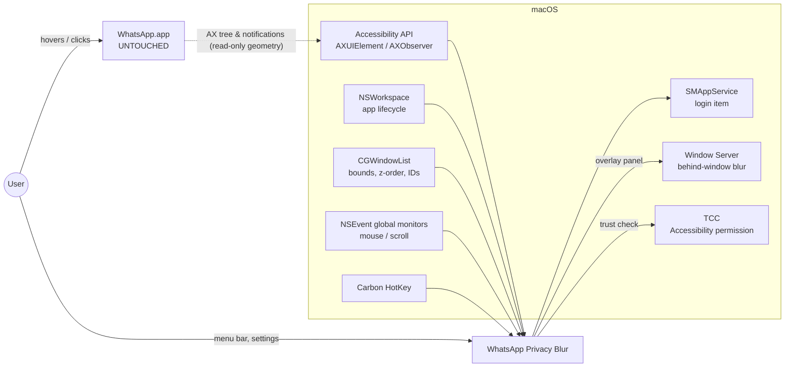

**Trust boundary:** WhatsApp *geometry* crosses into the app. WhatsApp *content* never does, and nothing leaves the Mac.

---

## 4. Logical Architecture

The four layers expand on the adapter → layout → engine split in §61.

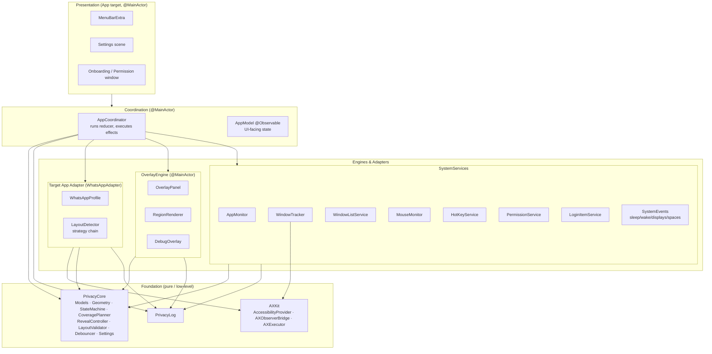

### 4.1 Dependency rules (enforced by SPM target dependencies)

1. `PrivacyCore` imports only `Foundation` and `CoreGraphics` (for `CGRect`). **No AppKit, no ApplicationServices.**
2. `AXKit` knows about AX but **not about WhatsApp**.
3. `WhatsAppAdapter` is the **only** module that mentions WhatsApp roles, bundle IDs or layout constants (§29, §61). It exposes a `TargetAppAdapter` conformance to the rest of the app.
4. `OverlayEngine` draws `[BlurRegion]`. It knows nothing about AX or WhatsApp (§40).
5. The App target is the **composition root**: it wires concrete types to protocols and holds no business logic.

### 4.2 Physical layout

> **Implementation note (Phase 1):** The dev machine has only the Command Line Tools, no Xcode. The project is therefore a **single root Swift package** instead of an `.xcodeproj` plus a local package:
> - Modules live in `Sources/<Module>` (`PrivacyCore`, `PrivacyLog`, and the `WhatsAppPrivacyBlur` executable target, which is the App target).
> - `scripts/build-app.sh` wraps the binary into a signed `.app` using `Support/Info.plist` (`LSUIElement`).
> - `scripts/test.sh` runs Swift Testing with the search paths the Command Line Tools need.
> - The settings model is named `PrivacySettings` to avoid clashing with SwiftUI's `Settings` scene.
> - Later modules (`AXKit`, `WhatsAppAdapter`, `OverlayEngine`, `SystemServices`) are added as targets in the same package.
>
> The module boundaries and dependency rules in §4.1 are unchanged.

```text
WhatsAppPrivacyBlur/
├── WhatsAppPrivacyBlur.xcodeproj
├── App/                                  # App target (composition root + UI)
│   ├── WhatsAppPrivacyBlurApp.swift      # @main, MenuBarExtra, Settings, Window scenes
│   ├── AppDelegate.swift                 # NSApplicationDelegate adaptor (lifecycle hooks)
│   ├── AppCoordinator.swift              # reducer runner + effect executor
│   ├── AppModel.swift                    # @Observable state for SwiftUI
│   ├── Dependencies.swift                # live wiring of protocols
│   ├── MenuBar/  MenuBarContent.swift
│   ├── Settings/ SettingsView.swift, GeneralTab, BlurTab, RevealTab, AdvancedTab
│   ├── Onboarding/ OnboardingView.swift, PermissionView.swift
│   └── Resources/ Info.plist (LSUIElement=YES), entitlements, Assets
│
├── Packages/PrivacyBlurKit/              # local Swift package
│   ├── Package.swift
│   ├── Sources/
│   │   ├── PrivacyCore/
│   │   │   ├── Models/      LayoutSnapshot, SidebarLayout, ChatRowLayout, BlurRegion, Coverage
│   │   │   ├── Geometry/    CoordinateSpace, TypedRect, CoordinateConverter, PixelAligner
│   │   │   ├── State/       ProtectionState, AppEvent, Effect, ProtectionReducer
│   │   │   ├── Coverage/    CoveragePlanner, CoveragePolicy
│   │   │   ├── Reveal/      RevealController, RevealEvent
│   │   │   ├── Detection/   LayoutValidator, DetectionConfidence, TargetAppAdapter (protocol)
│   │   │   ├── Settings/    Settings, SettingsStore (protocol), enums
│   │   │   └── Support/     Debouncer, Clock abstraction, Generation
│   │   ├── AXKit/           AXElement, AccessibilityProvider, LiveAccessibilityProvider,
│   │   │                    AXObserverBridge, AXExecutor, AXFailure, AXRole, AXSnapshotRecorder
│   │   ├── WhatsAppAdapter/ WhatsAppProfile(+.json), WhatsAppAdapter,
│   │   │                    Strategies/{AXHierarchyStrategy, KnownLayoutStrategy, GeometryHeuristicStrategy},
│   │   │                    RowClassifier, AnchorCache
│   │   ├── OverlayEngine/   OverlayPanel, OverlayController, RegionView, RegionRenderer,
│   │   │                    BlurStyleRenderer, OcclusionMask, DebugOverlayWindow
│   │   ├── SystemServices/  AppMonitor, WindowTracker, WindowListService, MouseMonitor,
│   │   │                    HotKeyService, PermissionService, LoginItemService, SystemEvents
│   │   └── PrivacyLog/      PrivacyLog, LogEvent, DiagnosticsRingBuffer
│   └── Tests/
│       ├── PrivacyCoreTests/     geometry, reducer, coverage, reveal, validator, debounce, settings
│       ├── WhatsAppAdapterTests/ strategy tests against recorded AX fixtures
│       ├── OverlayEngineTests/   region diffing, frame application
│       ├── PrivacyGuardTests/    static checks: no text APIs, no networking symbols
│       └── Fixtures/             AXSnapshots/*.json (roles + frames only, no text)
└── UITests/ (manual test harness + scripted integration against a fake target app)
```

How this maps to the folders proposed in §6:

| §6 folder | Lives in |
|---|---|
| App/ | App target |
| Accessibility/, Permissions/ | `AXKit`, `SystemServices/PermissionService` |
| WhatsApp/ | `WhatsAppAdapter` |
| Overlay/ | `OverlayEngine` (+ `PrivacyCore/Reveal` for pure hover logic) |
| Input/ | `SystemServices/MouseMonitor`, `HotKeyService` |
| Settings/, MenuBar/ | `PrivacyCore/Settings` (model) + App target (views) |
| Utilities/ | `PrivacyCore/Geometry`, `Support`, `PrivacyLog` |
| Tests/ | `Packages/PrivacyBlurKit/Tests` |

---

## 5. Concurrency and Runtime Model (Swift 6)

| Context | Runs | Why |
|---|---|---|
| `@MainActor` | Coordinator, reducer execution, OverlayEngine, MouseMonitor callbacks, RevealController, UI, NSWorkspace observers | AppKit needs it, and every state change is serialized in one place |
| `AXExecutor` (a custom `SerialExecutor` on a dedicated `DispatchQueue`, backing `actor AccessibilityWorker`) | AX tree walks, layout detection, CGWindowList queries | Keeps blocking IPC (F4) off the main thread |
| Main run loop | `AXObserver` run-loop sources | The C callbacks only translate a notification into an `AXEvent` and yield it to an `AsyncStream`. No AX calls happen in the callback. |

**Sendability.** `AXUIElement` is a CF type and safe to call from any thread, but it isn't `Sendable`. It is wrapped as `struct AXElement: @unchecked Sendable, Hashable` and **never leaves `AXKit` / `WhatsAppAdapter`**. Everything that crosses into the coordinator is a `Sendable` value type (`LayoutSnapshot`, `TypedRect`).

**Stale results.** Each detection request carries a monotonically increasing `Generation`. The reducer drops any `layoutDetected` event whose generation is older than the latest invalidation. This way a detection that started before a resize can never show pre-resize regions.

**Event flow:**

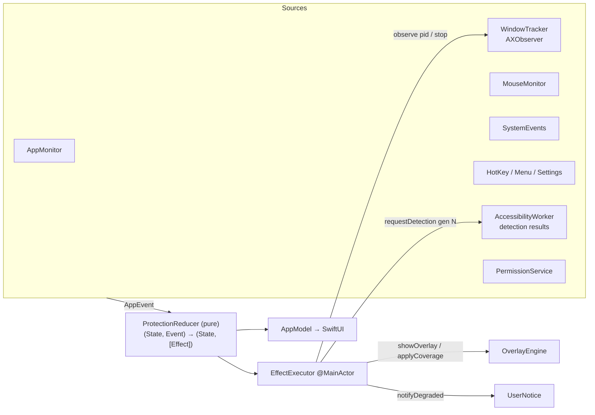

---

## 6. State Model

### 6.1 Protection state machine

This formalizes §7.1 and adds the suspended and degraded paths that the requirements imply (§8.2, §49–52, §59 reliability).

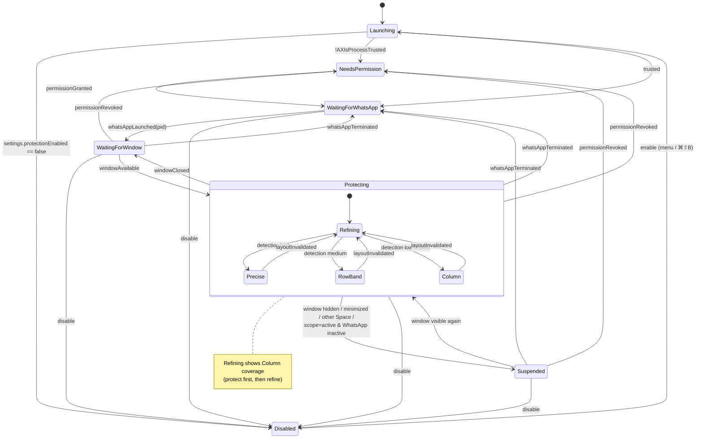

### 6.2 Core types (design signatures)

```swift
// PrivacyCore/State
public enum ProtectionState: Equatable, Sendable {
    case launching
    case disabled
    case needsPermission(PermissionPromptStatus)
    case waitingForWhatsApp
    case waitingForWindow(pid: pid_t)
    case suspended(pid: pid_t, window: TrackedWindow, reason: SuspendReason)
    case protecting(pid: pid_t, window: TrackedWindow, coverage: CoverageTier, generation: Generation)
}

public enum SuspendReason: Sendable { case minimized, appHidden, otherSpace, inactiveScope, systemAsleep }

public enum AppEvent: Sendable {
    // lifecycle
    case settingsChanged(Settings)
    case permissionChanged(trusted: Bool)
    case whatsAppLaunched(pid: pid_t), whatsAppTerminated(pid: pid_t)
    case whatsAppActivated, whatsAppDeactivated
    // window
    case windowAvailable(TrackedWindow), windowClosed
    case windowMoved(AXRect), windowResized(AXRect)
    case windowVisibilityChanged(visible: Bool, reason: SuspendReason?)
    // layout
    case layoutInvalidated(InvalidationReason)          // scroll, resize, treeChanged, typing, displays, wake
    case layoutDetected(LayoutSnapshot)                 // carries generation
    case detectionFailed(Generation, DetectionFailure)
    // input
    case scrollActivity(phase: ScrollPhase)
    // system
    case displaysChanged, systemWillSleep, systemDidWake, activeSpaceChanged
    case toggleProtection
}

public enum Effect: Sendable, Equatable {
    case startObserving(pid: pid_t), stopObserving
    case requestDetection(Generation, hint: DetectionHint)
    case showOverlay, hideOverlay
    case setOverlayLevel(OverlayLevelPolicy)           // .floating | .aboveWindow(CGWindowID)
    case applyCoverage(Coverage)                       // regions in AXRect space; engine converts
    case concealAll
    case promptPermissionOnce, openAccessibilitySettings
    case noticeDegradedMode                            // rate-limited by reducer state
    case setLoginItem(Bool), registerHotKey(KeyCombo?)
}

public struct ProtectionReducer {
    public static func reduce(_ state: inout CoreState, _ event: AppEvent) -> [Effect]
}
```

`CoreState` contains `ProtectionState` plus the caches the planner needs: the last valid `SidebarLayout`, the current generation, a consecutive-failure counter, a flag for whether the degraded notice has been shown, and `Settings`. The reducer is **pure and synchronous**, so every transition in §53.1 ("state transitions") is a table-driven unit test.

---

## 7. Component Specifications

### 7.1 AppCoordinator (App target)

- **Owns:** `CoreState`, the effect executor, and wiring of event streams into `send(_:)`.
- **Responsibilities (§7.1):** start every service, merge event sources, run the reducer, execute effects, and publish a projection to `AppModel`.
- **Contains no logic** beyond dispatch. A test double of `Dependencies` lets integration tests run the whole coordinator against fake services.

```swift
@MainActor final class AppCoordinator {
    init(deps: Dependencies, clock: any Clock<Duration>)
    func start()
    func send(_ event: AppEvent)
}
```

### 7.2 PermissionService (SystemServices)

| Concern | Design |
|---|---|
| Check | `AXIsProcessTrusted()` |
| Prompt | `AXIsProcessTrustedWithOptions([prompt: true])` **at most once per install**, tracked by a persisted flag (§9.3: no repeated prompting) |
| Deep link | `x-apple.systempreferences:com.apple.preference.security?Privacy_Accessibility` |
| Detect grant | (a) the distributed notification `com.apple.accessibility.api`, re-checked after a 500 ms delay because TCC updates lag; (b) `NSApplication.didBecomeActive`; (c) the "I've Granted Access" button; (d) a 2 s re-check **only while untrusted and the permission window is open** |
| Detect revoke | Any AX call returning `.apiDisabled` emits `permissionChanged(trusted:false)` |
| Dev note | TCC ties trust to the code signature. Sign dev builds with a stable identity or you'll be asked to grant access again on every build. |

### 7.3 AppMonitor (SystemServices)

- Watches `NSWorkspace.shared.notificationCenter` for `didLaunchApplication`, `didTerminateApplication`, `didActivateApplication`, `didDeactivateApplication`, `didHideApplication` and `didUnhideApplication`.
- Matches on `bundleIdentifier ∈ profile.bundleIdentifiers` (§8.1), never on path or process name.
- Scans `runningApplications` once at startup.
- If several instances are running, it uses the one that is active, or else the first one that is not terminated.
- "WhatsApp not installed" (§34): `NSWorkspace.urlForApplication(withBundleIdentifier:)` is `nil`, and the menu shows a hint. Nothing else changes.

### 7.4 AXKit — Accessibility abstraction (§38)

The API is **privacy-restricted by design**. It exposes geometry and structure only, never text values.

```swift
public struct AXElement: @unchecked Sendable, Hashable { /* wraps AXUIElement */ }

public enum AXFailure: Error, Sendable {
    case apiDisabled            // permission revoked
    case cannotComplete         // timeout / target busy
    case invalidElement         // element destroyed
    case attributeUnsupported, noValue
}

public protocol AccessibilityProvider: Sendable {
    func application(pid: pid_t) -> AXElement
    func windows(of app: AXElement) throws(AXFailure) -> [AXElement]
    func mainWindow(of app: AXElement) throws(AXFailure) -> AXElement?
    func frame(of element: AXElement) throws(AXFailure) -> AXRect
    func role(of element: AXElement) throws(AXFailure) -> AXRole         // API constants, not user content
    func subrole(of element: AXElement) throws(AXFailure) -> AXSubrole?
    func identifier(of element: AXElement) throws(AXFailure) -> String?  // developer-set AXIdentifier only
    func children(of element: AXElement) throws(AXFailure) -> [AXElement]
    func visibleChildren(of element: AXElement) throws(AXFailure) -> [AXElement]
    func isMinimized(_ window: AXElement) throws(AXFailure) -> Bool
    func isFullScreen(_ window: AXElement) throws(AXFailure) -> Bool

    /// Compares AXDescription/AXTitle to a fixed allow-list *inside* AXKit and returns only a Bool.
    /// Allowed only for structural containers (e.g., a list labelled "Chats"), never for row descendants.
    func label(of element: AXElement, matchesAnyOf allowList: Set<String>) -> Bool

    func setMessagingTimeout(_ seconds: Float, for app: AXElement)
}

public protocol AccessibilityObserving: Sendable {
    /// Registers notifications on elements; events delivered on the main run loop.
    func events(pid: pid_t, registrations: [AXRegistration]) -> AsyncStream<AXEvent>
}
```

- **Deliberately missing:** `value(of:)`, `title(of:)`, `description(of:)`, and any generic `attribute(_:)`. The `PrivacyGuardTests` target scans `AXKit` sources and fails if `kAXValueAttribute`, `kAXTitleAttribute`, `kAXDescriptionAttribute` or `kAXSelectedTextAttribute` is used outside `label(of:matchesAnyOf:)`.
- `AXSnapshotRecorder` (debug builds only) serializes a subtree as `{role, subrole, identifier, frame, children}`, with no text, into JSON fixtures for regression tests (§52, §61).
- `MockAccessibilityProvider` replays those fixtures in tests.

### 7.5 WindowTracker (SystemServices, uses AXKit)

**Picks the primary window (§51):** the `AXMainWindow` of WhatsApp's app element. It falls back to `AXFocusedWindow`, then to the largest standard window (subrole `AXStandardWindow`). Secondary windows are ignored in the MVP.

**Maps the AX window to a `CGWindowID`:** it looks for a `CGWindowList` entry with the same owner PID, `layer == 0`, and bounds equal to the AX frame within ±1 pt. It then re-checks on each move or resize. No private `_AXUIElementGetWindow` is used.

**AX notifications registered:**

| Element | Notifications |
|---|---|
| Application | `kAXWindowCreated`, `kAXMainWindowChanged`, `kAXFocusedWindowChanged`, `kAXApplicationHidden`, `kAXApplicationShown` |
| Primary window | `kAXMoved`, `kAXResized`, `kAXWindowMiniaturized`, `kAXWindowDeminiaturized`, `kAXUIElementDestroyed` |
| Chat list anchor (from adapter) | `kAXValueChanged` on the scroll bar, `kAXRowCountChanged`, `kAXCreated`, `kAXUIElementDestroyed`, `kAXLayoutChanged`, `kAXSelectedRowsChanged` |

The adapter supplies the anchor element through `TargetAppAdapter.observationTargets`, so the tracker never learns WhatsApp's structure.

**Handling a live drag (§26, 100 ms target), SPIKE S4.** Some apps emit `kAXMoved` only when a drag ends. To cover that:
- On a global `leftMouseDown` inside WhatsApp's title-bar band (from cached window geometry) while WhatsApp is frontmost, start a **display-linked sampler** (`NSView.displayLink`, macOS 14+) that reads only `frame(of: window)`.
- Stop it on `leftMouseUp` or after 300 ms with no change.
- This is bounded, event-triggered sampling rather than continuous polling (§32).
- A **move** only translates the overlay window. It does not trigger re-detection, because regions are relative to the sidebar.

### 7.6 Target App Adapter and the Layout Detection Pipeline (§11–13, §29, §61)

```swift
// PrivacyCore/Detection — the only contract the rest of the app sees
public protocol TargetAppAdapter: Sendable {
    var bundleIdentifiers: Set<String> { get }
    func detectLayout(pid: pid_t, window: TrackedWindow, hint: DetectionHint,
                      generation: Generation) async -> DetectionOutcome
    func observationTargets(pid: pid_t) async -> [AXRegistration]
    func prepare(pid: pid_t) async               // e.g., set AXManualAccessibility for Electron
}

public enum DetectionOutcome: Sendable {
    case detected(LayoutSnapshot)
    case failed(Generation, DetectionFailure)
}
```

**Strategy chain.** The chain follows the priority order in §11.2. It stops at the first result that passes validation.

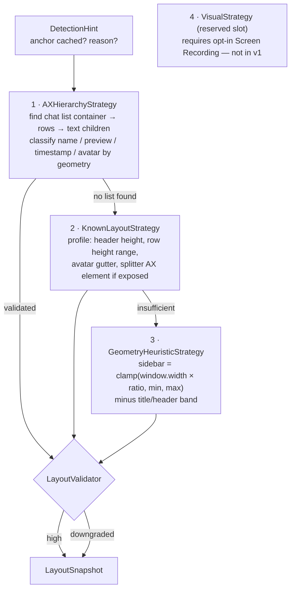

**AXHierarchyStrategy details:**

1. **Anchor lookup.**
   - *Fast path:* the `AnchorCache` holds the `AXElement` of the chat-list container (for example an `AXTable`, `AXOutline`, `AXList`, or an `AXScrollArea` → `AXGroup` pattern defined in the profile). If it's still valid, only `visibleChildren(of: anchor)` is fetched.
   - *Slow path:* a breadth-first walk from the window, limited by the profile's `maxDepth` (for example 12) and `maxElements` (for example 1500). It takes the leftmost vertically scrolling container whose frame starts at the window's left edge and whose height is at least 50% of the window. Structural label matching goes through `label(of:matchesAnyOf:)`.
2. **Rows.** Rows are the anchor's visible children, clipped to the list viewport.
3. **RowClassifier.** Classification is **pure geometry and never reads text**:
   - Sort the row's text-role descendants by `(minY, minX)`.
   - The top-left text is the **name**, the right-aligned text on the top line is the **timestamp**, and text on lower lines is the **preview**. Media and link labels in the preview line belong to the preview (§19.1).
   - An image-role element or a square-ish element at the left edge is the **avatar**.
   - Unread badges, mute icons and pins on the preview line fall inside the preview band, so they get blurred too. That's harmless and errs toward privacy.

**LayoutValidator** (pure, in `PrivacyCore`) decides confidence. Every rule is unit tested.

| Rule | Fails → |
|---|---|
| Sidebar lies inside the window, and its width is within `[profile.minSidebar, window.width × 0.7]` | reject |
| Row heights are within `profile.rowHeightRange`, rows are sorted and don't overlap by more than 1 pt | at most `low` |
| **The union of row frames covers ≥ 90% of the list viewport height** (catches rows the walk missed) | at most `low` |
| Every row has a `previewFrame` inside the row | at most `medium` |
| All pass | `high` |

**Coverage tiers.** These implement §13, §35 and §56.

| Confidence | Tier | Regions produced |
|---|---|---|
| high | **T0 Precise** | Per-row preview rects, plus name, timestamp or avatar rects when those targets are enabled (§19) |
| medium | **T1 RowBand** | Per-row band = row minus avatar gutter, lower text line(s) |
| low | **T2 Column** | One region: the list viewport minus the avatar gutter. Hover uses a *spotlight band* (see §7.9). |
| none (window known, no sidebar) | **T3 WindowHeuristic** | Left part of the window from the profile ratio (for example 32%, clamped to 280–520 pt), below the title bar |
| no window geometry | — | Overlay hidden. The menu shows "Can't locate WhatsApp window". There's nothing to cover. |

`settings.forceFallback` (§22 Advanced) pins the tier at T2 or lower.

**Degraded mode (§52).** After **5 consecutive** failures or low-confidence results *within one WhatsApp version* (read from the target bundle's public `CFBundleShortVersionString`), the reducer emits `noticeDegradedMode` once per version.

**WhatsAppProfile** is a versioned JSON resource, so adapting to a UI change is a data edit plus fixtures, not a rewrite:

```json
{
  "schema": 1,
  "bundleIdentifiers": ["net.whatsapp.WhatsApp"],
  "legacyElectronBundleIdentifiers": ["desktop.WhatsApp"],
  "list": { "roles": ["AXTable", "AXOutline", "AXList", "AXScrollArea"], "labelAllowList": ["Chats", "Chat list"] },
  "rowHeightRange": [52, 100],
  "avatarGutter": 64,
  "sidebar": { "minWidth": 240, "fallbackRatio": 0.32, "fallbackMin": 280, "fallbackMax": 520 },
  "headerBand": 112,
  "regionPadding": { "dx": 2, "dy": 2 },
  "walk": { "maxDepth": 12, "maxElements": 1500 }
}
```

All numbers above are placeholders until **SPIKE S1** measures the real app.

### 7.7 CoveragePlanner (PrivacyCore, pure)

```swift
public struct CoveragePlanner {
    public static func plan(
        snapshot: LayoutSnapshot?,       // latest valid, may be nil
        cachedSidebar: SidebarLayout?,   // last known sidebar geometry
        window: AXRect,
        invalidated: Bool,               // true while waiting for refinement
        settings: Settings,
        profile: CoverageProfile         // padding, gutters (injected from adapter, no WhatsApp names)
    ) -> Coverage
}

public struct Coverage: Equatable, Sendable {
    public var tier: CoverageTier
    public var overlayFrame: AXRect          // sidebar frame (outset), or window heuristic
    public var regions: [BlurRegion]         // AX global space; clipped to list viewport
}
```

**Invariants.** Property-based tests check all of these:

1. **Monotonic safety:** when `invalidated == true`, the covered area is at least the area of T2 computed from `cachedSidebar`. Invalidation never shrinks coverage.
2. Every region is clipped to the list viewport. Rows that have scrolled out produce no region (§28).
3. Regions are padded by `regionPadding` to cover descenders and antialiasing.
4. Rows only partly inside the viewport still get their visible part covered.

### 7.8 OverlayEngine (§14, §15, §40)

**OverlayPanel** (subclass of `NSPanel`):

| Property | Value | Req |
|---|---|---|
| `styleMask` | `[.borderless, .nonactivatingPanel]` | no chrome, never steals focus |
| `isOpaque` / `backgroundColor` | `false` / `.clear` | transparent |
| `hasShadow` | `false` | |
| `ignoresMouseEvents` | `true`, always | click-through (§14.2) |
| `canBecomeKey` / `canBecomeMain` | `false` | |
| `hidesOnDeactivate` | `false` | |
| `collectionBehavior` | `[.canJoinAllSpaces, .fullScreenAuxiliary, .stationary, .ignoresCycle]` | fullscreen (§50), not in ⌘\` or Mission Control cycling |
| `sharingType` | default (`.readOnly`) | blur also appears in screen shares (F11) |
| `isExcludedFromWindowsMenu` | `true` | |
| Accessibility | `setAccessibilityElement(false)` on the panel and every view | doesn't interfere with VoiceOver (§47) |
| `animationBehavior` | `.none` | no pop animation when moving |

**Level policy (F8).** This is an `OverlayLevelPolicy` effect decided by the reducer:

- WhatsApp **frontmost**: `level = .floating`, which is reliably above WhatsApp.
- WhatsApp **in the background** with scope `whileWhatsAppVisible`: `level = .normal` and `order(.above, relativeTo: whatsAppWindowID)`. The order is re-applied on `didActivateApplication` for *any* app and on `activeSpaceChanged`.
- **Fallback if S3 shows cross-process relative ordering is unreliable:** keep `.floating` and apply an **OcclusionMask**. CGWindowList z-order gives the rects of windows stacked above WhatsApp's window, and those are subtracted from the regions through a `CAShapeLayer` mask. That takes no permission and uses bounds only.

**Visibility checks:** the window ID is in `CGWindowListCopyWindowInfo(.optionOnScreenOnly)`, the window isn't minimized, and the app isn't hidden. These run on `activeSpaceChanged`, hide/unhide, and minimize/deminiaturize. If any check fails, the reducer suspends.

**RegionRenderer:**

- A pool of `RegionView`s keyed by `RegionID`, diffed on each `applyCoverage` (insert, update frame, remove). No view churn during scrolling.
- Frame updates run inside `CATransaction.setDisableActions(true)`, so geometry never animates and there's no lag trail.
- Reveal and conceal animate `alphaValue` with `NSAnimationContext` over **150 ms, ease-in-out** (§16.2). Concealing after scroll or invalidation is **instant (0 ms)**, because privacy wins over smoothness.
- Rects are **pixel-aligned** to the backing scale of the screen that contains them (§24–25).

**BlurStyleRenderer** (§15). Styles are pluggable through `protocol BlurStyleRenderer { func makeLayerTree(for: RegionKind, intensity: Double, appearance: NSAppearance) -> NSView }`:

| Style | Implementation | Intensity mapping (Low / Medium / High) |
|---|---|---|
| **Material** (default) | `NSVisualEffectView(blendingMode: .behindWindow, state: .active)` + tint `CALayer` + 6 pt corner radius | material `.popover` / `.hudWindow` / `.hudWindow`; tint alpha **0.35 / 0.55 / 0.8** (floor set by S2 legibility test) |
| **Solid** | `CALayer` filled with `NSColor.windowBackgroundColor`, adapted to appearance | alpha 0.92 / 0.97 / 1.0 |
| **Gaussian** (future) | ScreenCaptureKit + `CIGaussianBlur`, needs opt-in Screen Recording, frames never persisted | radius 8 / 14 / 22 |

**Theme (§2.1-14).** WhatsApp follows the system appearance by default, so regions use `NSApp.effectiveAppearance` and update on `effectiveAppearance` KVO. A setting `overlayAppearance: .system | .light | .dark` covers users who override WhatsApp's theme, since their pixels can't be sampled without Screen Recording.

**Placement across displays (§24).** The panel frame is `CoordinateConverter.toAppKit(coverage.overlayFrame)`. A panel spanning two displays renders on both. The backing scale for alignment comes from the screen that contains the region's midpoint.

**DebugOverlay (§36).** A separate click-through panel draws outlines of the window, sidebar, list viewport, rows and regions, labelled with tier, confidence, generation and strategy. It shows **numbers only**. It's hidden unless Advanced → "Show debug overlay" is on, and it's compiled into release builds but off by default.

### 7.9 Input and Reveal (§16–18, §41–42)

**MouseMonitor** (SystemServices). It registers global monitors for `.mouseMoved`, `.leftMouseDragged`, `.leftMouseDown`, `.leftMouseUp`, `.scrollWheel` and `.flagsChanged`, and filters in this order, cheapest first (§42):

```text
event
 ├─ state != protecting                        → drop (monitors removed entirely when not protecting)
 ├─ revealMethod == .disabled && not scroll    → drop
 ├─ point ∉ cachedOverlayFrame (AppKit space)  → if a region is revealed: send pointerExited; else drop
 └─ forward (point in AX space, timestamp, phase) → RevealController / Coordinator
```

Monitors are **installed only while protecting**. When WhatsApp isn't running, there are no mouse callbacks at all.

**Scroll handling (§28).**
- `scrollWheel` inside the overlay frame with phase `.began`, or any delta: emit `scrollActivity(.active)`. The reducer then sets `invalidated = true`, and the planner switches to T2 immediately, synchronously and without AX. It also conceals all regions.
- No scroll events for **120 ms**, including the momentum phase: emit `scrollActivity(.ended)`, then `requestDetection` using the fast path on the cached anchor.
- The AX `kAXValueChanged` notification on the list scroll bar also invalidates, which covers keyboard and programmatic scrolling.

**Other invalidation sources:**
- `keyDown` while WhatsApp is frontmost and the pointer is in the sidebar area. This is caught through `kAXLayoutChanged` / `kAXRowCountChanged` on the anchor. No key monitor is needed, and the app never reads keys.
- Incoming messages reorder chats but keep the row *slot* geometry, so T0 regions stay correct. The `kAXCreated` / `kAXUIElementDestroyed` notifications on the anchor trigger a refine anyway.

**RevealController** (PrivacyCore, pure, uses an injected `Clock`):

```swift
public struct RevealController {
    public mutating func handle(_ input: RevealInput, now: ContinuousClock.Instant) -> [RevealOutput]
}
public enum RevealInput  { case pointerMoved(AXPoint), pointerExitedOverlay, click(AXPoint),
                           modifierChanged(optionDown: Bool), regionsReplaced([BlurRegion]),
                           invalidated, timerFired(RegionID), settingsChanged(RevealSettings) }
public enum RevealOutput { case reveal(RegionID), conceal(RegionID, animated: Bool),
                           scheduleTimer(RegionID, Duration), cancelTimer(RegionID) }
```

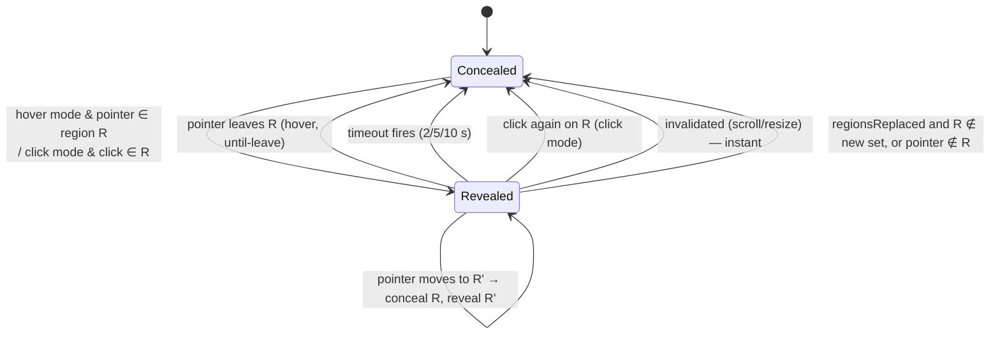

- **Precision (§16.3):** hit-testing uses only regions whose `kind == .preview`, or all enabled kinds when `revealScope == .wholeRow`. Names, avatars, timestamps and empty space never match unless configured.
- **At most one region revealed at a time.**
- **Hover in T2 or T3:** a *spotlight band* reveals a horizontal band of `profile.estimatedRowHeight` centered on the pointer's row slot. It's implemented as a mask hole in the column region.
- **Click mode, "user changes chat":** a `kAXSelectedRowsChanged` notification on the anchor maps to `.invalidated` for the reveal controller.
- **Hit-test cost:** a linear scan of 50 or fewer rects is much faster than the event rate. No spatial index is needed.

### 7.10 Settings, Menu Bar, Onboarding, Hot Key, Login (§20–23, §44, §48)

```swift
public struct Settings: Codable, Sendable, Equatable {
    public var schemaVersion = 1
    // General
    public var protectionEnabled = true
    public var enableAutomaticallyOnLaunch = true
    public var launchAtLogin = false
    public var protectionScope: ProtectionScope = .whileWhatsAppVisible     // see §2 conflict
    // Blur
    public var targets = PrivacyTargets(previews: true, names: false, timestamps: false, avatars: false)
    public var blurStyle: BlurStyle = .material
    public var intensity: Double = 0.5                                     // presets: 0.2 / 0.5 / 0.85
    public var overlayAppearance: AppearanceOverride = .system
    // Reveal
    public var revealMethod: RevealMethod = .hover                         // .hover .click .hoverAndClick .optionHover .disabled
    public var revealTimeout: RevealTimeout = .untilPointerLeaves          // .seconds(2|5|10)
    public var revealScope: RevealScope = .previewOnly                     // .wholeRow
    // Advanced
    public var forceFallback = false
    public var showDebugOverlay = false
    public var diagnosticLogging = false
    public var toggleShortcut: KeyCombo? = .init(key: .b, modifiers: [.command, .shift])
}

public protocol SettingsStore: Sendable {
    func load() -> Settings                    // migrates by schemaVersion; corrupt → defaults
    func save(_ settings: Settings)
    var changes: AsyncStream<Settings> { get }
}
```

- **Persistence:** a single JSON blob in `UserDefaults` under key `settings.v1`. The only other key is `permission.promptedOnce`. **Nothing else is persisted.**
- **Menu bar (§21):** SwiftUI `MenuBarExtra(.menu)` with a lock SF Symbol (`lock.fill`, or `lock.open` when disabled or suspended). It holds a Protection toggle, a Reveal on Hover toggle, an Intensity picker (shown as a submenu), a status line ("Protecting · Precise", "Waiting for WhatsApp", "Needs permission"), Settings… (`SettingsLink` + `NSApp.activate`), Check for Updates…, and Quit.
- **Settings scene:** a SwiftUI `Settings` window with General, Blur, Reveal and Advanced tabs. It uses native `Form` controls with explicit `accessibilityLabel`s and full keyboard navigation (§47).
- **Onboarding (§44):** a SwiftUI `Window` scene shown when `permission.promptedOnce == false` or while untrusted. It moves from Welcome → Permission (§9.2 copy) → "You're protected".
- **HotKeyService:** Carbon `RegisterEventHotKey` (F6). The shortcut can be changed in Settings with a small recorder control. On conflict, the service shows an inline error and doesn't register.
- **LoginItemService:** `SMAppService.mainApp.register()` / `unregister()`. It reads the status back so the UI reflects "requires approval" (§23).
- **Notifications (§45):** only the degraded-mode notice and, optionally, one "active" notice on first protection. They go through `UNUserNotificationCenter` with authorization requested lazily. There are no per-state-change notifications.

### 7.11 PrivacyLog (§37)

```swift
public enum LogEvent: Sendable {
    case whatsAppDetected(pidHash: UInt8), whatsAppTerminated
    case windowTracked, windowLost
    case layoutDetected(strategy: StrategyID, confidence: DetectionConfidence, rows: Int, ms: Int)
    case coverageApplied(tier: CoverageTier, regions: Int)
    case detectionFailed(DetectionFailure)
    case permission(trusted: Bool)
    case stateTransition(from: StateTag, to: StateTag)
}
public enum PrivacyLog {
    static func record(_ event: LogEvent, level: OSLogType = .info)
}
```

- The API takes **only `LogEvent` cases**. There's no `String` parameter, so AX text can't be interpolated into logs.
- It is backed by `os.Logger` (subsystem `…privacyblur`, categories per module).
- When "diagnostic logging" is on, a bounded in-memory ring buffer of 500 events can be exported by the user as JSON. It is never written to disk automatically.

### 7.12 SystemEvents (§59 reliability)

| Signal | Source | Reaction |
|---|---|---|
| Sleep / wake | `NSWorkspace.willSleepNotification` / `didWakeNotification` | Suspend, then on wake **rebuild the AXObserver**, re-resolve the window, and run a full detection |
| Display config | `NSApplication.didChangeScreenParametersNotification` | Update the converter's primary height, re-place the overlay, invalidate and detect |
| Space change | `NSWorkspace.activeSpaceDidChangeNotification` | Visibility check (§7.8) |
| Appearance | `NSApp` `effectiveAppearance` KVO | Restyle regions |
| Screen lock | `com.apple.screenIsLocked` / `…Unlocked` (distributed) | Suspend / resume |

---

## 8. Data Models (§39)

```swift
// Phantom-typed geometry — see §11
public struct TypedRect<Space: CoordinateSpace>: Equatable, Sendable { public var raw: CGRect }
public typealias AXRect = TypedRect<AXGlobal>          // top-left origin, points
public typealias ScreenRect = TypedRect<AppKitGlobal>  // bottom-left origin, points
public typealias OverlayRect = TypedRect<OverlayLocal> // relative to overlay content view

public struct TrackedWindow: Equatable, Sendable {
    public var windowID: CGWindowID
    public var frame: AXRect
    public var isFullScreen: Bool
}

public struct LayoutSnapshot: Equatable, Sendable {
    public let generation: Generation
    public let window: AXRect
    public let sidebar: SidebarLayout?
    public let confidence: DetectionConfidence   // .high .medium .low .none
    public let strategy: StrategyID
    public let durationMs: Int
}

public struct SidebarLayout: Equatable, Sendable {
    public var frame: AXRect
    public var listViewport: AXRect              // scrollable area below header/search
    public var rows: [ChatRowLayout]
}

public struct ChatRowLayout: Equatable, Sendable {
    public var slot: Int                         // 0 = topmost visible row
    public var frame: AXRect
    public var avatarFrame: AXRect?
    public var nameFrame: AXRect?
    public var previewFrame: AXRect?
    public var timestampFrame: AXRect?
}

public enum RegionKind: Sendable { case preview, name, timestamp, avatar, rowBand, column, windowHeuristic }
public struct RegionID: Hashable, Sendable { public var slot: Int; public var kind: RegionKind }

public struct BlurRegion: Identifiable, Equatable, Sendable {
    public let id: RegionID
    public var frame: AXRect
    public var isRevealed: Bool
}
```

No model has a field that can hold WhatsApp text. This is the structural guarantee behind §30.2.

---

## 9. Key Flows

### 9.1 Startup → protected

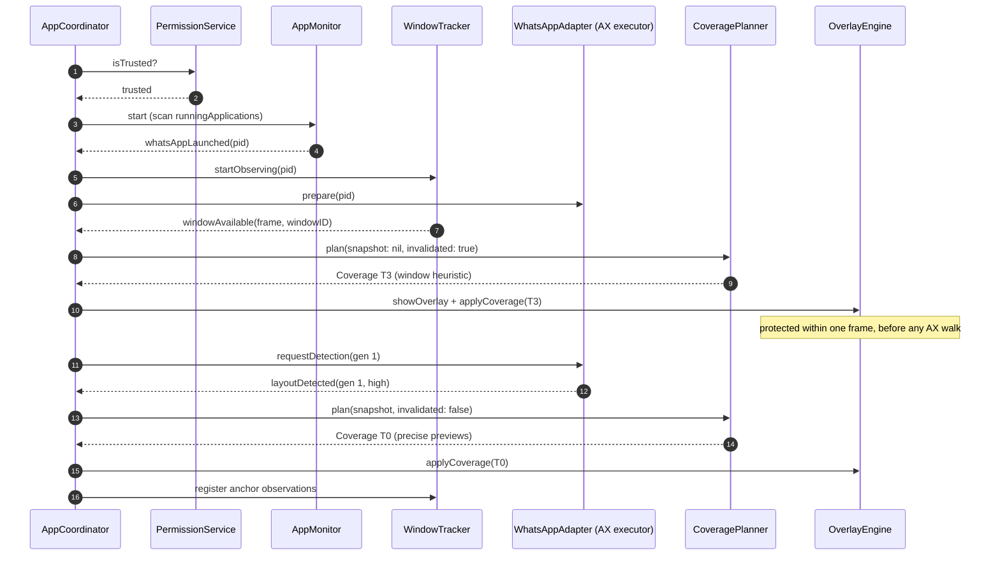

### 9.2 Resize (§27)

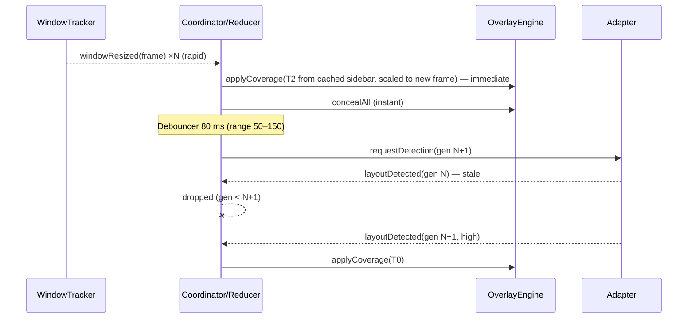

### 9.3 Scroll (§28)

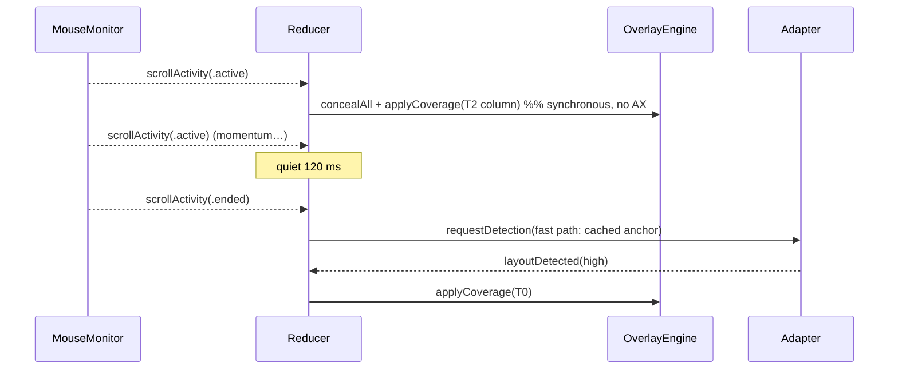

### 9.4 Hover reveal (§16, §41)

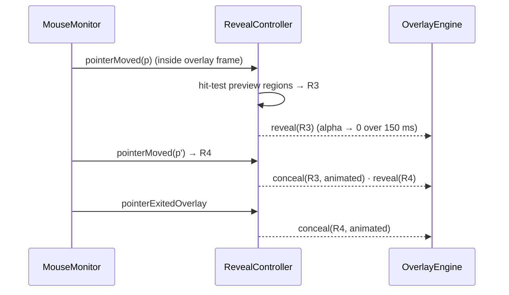

### 9.5 App switch and visibility (§49, Test 8)

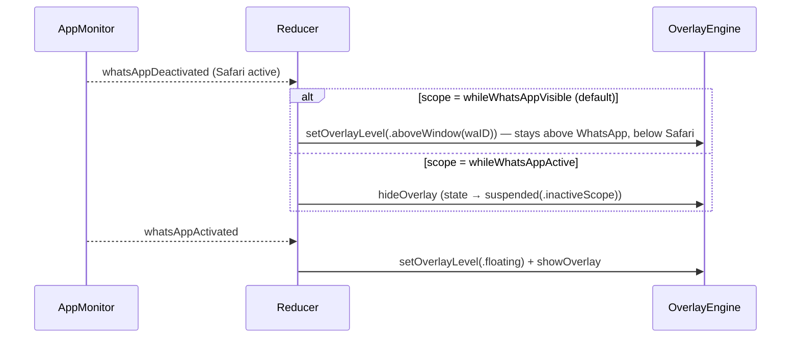

### 9.6 Permission revoked while running

`AX call → .apiDisabled` → `permissionChanged(false)` → the reducer:

1. **Keeps the current overlay at T3** based on the last `CGWindowList` bounds, which are still readable without AX. This is failsafe.
2. Shows the permission status in the menu.
3. Stays in `needsPermission` without prompting again.

If WhatsApp's window moves after that, the overlay follows through `CGWindowList` bounds, re-queried only on `didActivateApplication` and mouse-up events. This way protection degrades to a coarse cover instead of disappearing.

---

## 10. Failsafe Matrix (§34, §35)

| Failure | Detected by | Behavior | User-visible |
|---|---|---|---|
| WhatsApp not installed | `urlForApplication` nil | Idle, no monitors | Menu: "WhatsApp not found" |
| WhatsApp not running | AppMonitor | Overlay hidden, zero monitors | Menu: "Waiting for WhatsApp" |
| Permission denied | PermissionService | No AX. Onboarding and menu status. | Permission UI (§9.3) |
| Permission revoked mid-session | `.apiDisabled` | T3 cover from CGWindowList bounds | Menu status |
| Window unavailable or minimized | AX / CGWindowList | Suspended, overlay hidden (nothing visible to protect) | — |
| AX tree unexpected | Strategy chain / validator | Downgrade to T2 or T3 | Degraded notice after 5 in a row (once per version) |
| AX timeout (WhatsApp hung) | `.cannotComplete` | Keep last coverage, **escalate to T2**, retry with backoff 250 ms → 1 s → 4 s | — |
| Element destroyed mid-walk | `.invalidElement` | Abort walk, clear anchor cache, retry once from slow path | — |
| Display change | SystemEvents | Invalidate → T2 → re-detect | — |
| Sleep / wake | SystemEvents | Rebuild observers, full detection | — |
| WhatsApp restart | pid change | Tear down, restart pipeline | — |
| Our app crash | — | Overlay disappears with the process (unavoidable). Launch-at-login restores it on next login. Crash-free goal is covered by tests. | — |

---

## 11. Coordinate System Specification (§24–25)

All conversion lives in `PrivacyCore/Geometry/CoordinateConverter`. **No other file may convert coordinates.** A lint rule rejects `NSScreen.screens[0].frame.height` and `convert(` outside this module.

```swift
public enum AXGlobal: CoordinateSpace {}       // origin: top-left of primary display; y grows down
public enum AppKitGlobal: CoordinateSpace {}   // origin: bottom-left of primary display; y grows up
public enum OverlayLocal: CoordinateSpace {}   // origin: bottom-left of overlay content view

public struct CoordinateConverter: Sendable {
    public var primaryDisplayHeight: CGFloat   // NSScreen.screens[0].frame.height (NOT NSScreen.main)
    public var screens: [ScreenInfo]           // frame (AppKit) + backingScaleFactor

    public func toAppKit(_ r: AXRect) -> ScreenRect   // y' = H − y − h
    public func toAX(_ r: ScreenRect) -> AXRect
    public func toOverlay(_ r: AXRect, overlayFrame: AXRect) -> OverlayRect
    public func toAX(_ p: NSPointInAppKit) -> AXPoint   // for mouse events (NSEvent.mouseLocation)
    public func pixelAligned(_ r: ScreenRect) -> ScreenRect  // round outward to 1/backingScale of containing screen
}
```

Test matrix: a single display; a secondary display to the left, right, above or below with negative origins; mixed 1× and 2× scaling; a 2× primary with a 1× secondary; regions straddling two displays.

---

## 12. Performance Design (§32–33)

| Scenario | Wakeups | Budget |
|---|---|---|
| WhatsApp not running | NSWorkspace notifications only | ~0% CPU |
| Protecting, user idle | AX notifications only. **Optional** heartbeat validation every 3 s reads 2 frames (window + anchor), no tree walk, and can be turned off. | < 0.5% CPU |
| Pointer moving over sidebar | ≤ display rate; O(n ≤ 50) hit test | < 2% CPU |
| Detection fast path (cached anchor) | Per invalidation (debounced) | p95 < 25 ms on the AX executor |
| Detection slow path (full walk) | On anchor loss only | p95 < 120 ms, hard cap 250 ms / 1500 elements |
| Live drag sampling | Only between mouse down and up on the title bar | display-linked, window frame read only |
| Memory | — | Target < 40 MB, limit 100 MB |

- **Techniques:** the anchor cache, `kAXVisibleChildrenAttribute` instead of the full child list, view pooling, geometry updates with animations disabled, and monitors installed only while protecting.
- **Instrumentation:** `os_signpost` intervals around detection and `applyCoverage`. Performance tests run the detection pipeline over large recorded fixtures (200 rows).

---

## 13. Security, Privacy and Distribution (§30–31)

### 13.1 Privacy enforcement

| Guarantee | Mechanism |
|---|---|
| No message content read | AXKit exposes no text-returning API. `PrivacyGuardTests` scans sources for forbidden AX attribute constants. |
| No content stored | Models have no text fields. Persistence is limited to `settings.v1` and `permission.promptedOnce`. A test asserts the set of `UserDefaults` keys. |
| No content logged | `PrivacyLog` accepts only typed `LogEvent`s. `os.Logger` interpolations are banned outside `PrivacyLog` by a SwiftLint custom rule. |
| No network | No networking code outside the optional `Updater` target (Sparkle). A CI check fails if `URLSession`, `NWConnection`, `CFSocket` or `Network.framework` appear in other targets. A release-build check lists linked frameworks. |
| No clipboard | CI check bans `NSPasteboard` outside the settings diagnostics "Copy" button. |
| No Screen Recording | Not requested in v1. `CGWindowList` is used only for bounds, IDs and layer. `kCGWindowName` is never accessed (lint rule). |
| No WhatsApp modification | Read-only AX, except setting `AXManualAccessibility` for **legacy Electron only**, behind a profile flag. It's documented as an accessibility flag, not a change to the app. |

### 13.2 Build and distribution

- Unsandboxed (F3), **Hardened Runtime** on, no JIT or unsigned-memory entitlements, no `com.apple.security.cs.disable-library-validation`.
- Developer ID signed, **notarized**, stapled DMG.
- `Info.plist`: `LSUIElement = YES`, `NSAccessibilityUsageDescription` holding the §9.1 copy, and `LSMinimumSystemVersion = 14.0`.
- Updates: Sparkle 2 with EdDSA-signed appcast, `SUEnableAutomaticChecks = NO` by default, user-initiated only.
- Architectures: `arm64` in v1, with `x86_64` added as a universal build later. The code has no architecture-specific paths.

---

## 14. Testing Architecture (§53–54)

| Layer | Test type | How |
|---|---|---|
| `PrivacyCore` | Unit, property-based | Reducer transition tables; CoveragePlanner invariants (monotonic safety, clipping); LayoutValidator rules; RevealController with `TestClock`; Debouncer with `TestClock`; converter matrix; Settings Codable migration |
| `WhatsAppAdapter` | Fixture-based | `MockAccessibilityProvider` replays `Fixtures/AXSnapshots/*.json` (light/dark, pinned, muted, unread, groups, media, empty preview, 200 rows, narrow sidebar). Expected `LayoutSnapshot`s are golden files. Each new WhatsApp version adds a fixture. |
| `OverlayEngine` | Unit + snapshot | Region diffing (insert/update/remove by `RegionID`); level policy; accessibility-element flags; `sharingType` assertion |
| Coordinator | Integration with fakes | Fake AppMonitor, WindowTracker, Adapter and MouseMonitor drive the scripted scenarios for privacy Tests 1–8 in §54, checking that the overlay effect stream never shows a moment where a visible preview region is uncovered |
| System | Integration with a **fake target app** | A tiny AppKit test app with a sidebar of `NSTableView` rows, registered under a test profile. XCUITest-style harness moves, resizes and scrolls it and asserts overlay frames through the debug-state endpoint (DEBUG only). |
| Manual | Checklist | §53.3 matrix, run against real WhatsApp each release. Blur legibility check at every intensity, photographed from 1 m. |

**Privacy invariant test.** This is the key test. Over randomized event sequences (move, resize, scroll, detection success or failure or staleness, app switch), after each event:

> `union(coverage.regions) ⊇ previewFrames(groundTruthLayout) ∩ visibleViewport`, unless a reveal is active for exactly one region under the pointer.

---

## 15. Implementation Phases (maps §60)

| Phase | Components | Exit criteria |
|---|---|---|
| **0 · Spikes** (new) | S1–S5 below | Findings recorded in `docs/spikes/*.md`. Profile numbers filled in. F2 and F8 resolved. |
| 1 · Foundation | App target, MenuBarExtra, Settings model and store, PrivacyLog, reducer skeleton, package layout | Menu-bar app toggles state. Reducer tests green. |
| 2 · Accessibility | AXKit, PermissionService, AppMonitor, WindowTracker, CoordinateConverter | Debug overlay outlines WhatsApp's window through move, resize, displays and restart |
| 3 · Overlay | OverlayPanel, RegionRenderer (Material/Solid), level policy, T3 coverage | A blur block follows WhatsApp, click-through, correct stacking with other apps |
| 4 · Sidebar | Adapter + KnownLayout/GeometryHeuristic strategies, validator, T2, scroll invalidation | Sidebar column protected through resize and scroll. Privacy invariant test green for T2. |
| 5 · Chat rows | AXHierarchyStrategy, RowClassifier, anchor cache, T0/T1, fixtures | Only previews are blurred. Fixture suite green. |
| 6 · Hover reveal | MouseMonitor, RevealController, animations, spotlight band | §54 Tests 2–3 |
| 7 · Settings | Settings UI, targets, intensity, reveal modes and timeout, HotKey, LoginItem, onboarding | §22 complete |
| 8 · Hardening | SystemEvents, fullscreen and Spaces, occlusion fallback, perf signposts, notarization | §59 Definition of Done |

The **MVP cut** (§55–56) is Phases 1–4 plus Phase 6 with the spotlight band. Phase 5 improves precision but isn't needed for the MVP to protect privacy.

### 15.1 Phase 0 spikes

| ID | Question | Method | Decides |
|---|---|---|---|
| S1 | What does WhatsApp's AX tree look like? Is the chat list exposed with row children and text frames? | Accessibility Inspector plus an `AXSnapshotRecorder` CLI on the current WhatsApp in light and dark | Whether T0 is feasible for MVP; the profile JSON |
| S2 | At which material and tint does 13 pt preview text become unreadable? | Overlay prototype over WhatsApp on Retina and non-Retina, photographed | Intensity table; legibility floor |
| S3 | Does `order(.above, relativeTo:)` with another process's window number hold stacking? How long does exposure last on activation? | Prototype panel + screen recording at 120 fps | Level policy vs occlusion-mask fallback |
| S4 | Which AX notifications fire during live drag, resize, scroll and search typing? | Observer logger | Need for the drag sampler; invalidation sources |
| S5 | Are CGWindowList bounds and IDs available without Screen Recording on macOS 14, 15 and current? | Test on clean user accounts | Window ID matching; permission-revoked failsafe |

---

## 16. Risk Register

| Risk | Likelihood | Impact | Mitigation |
|---|---|---|---|
| WhatsApp AX tree is sparse (Catalyst) | Medium | Precision only | T1–T3 tiers. The MVP doesn't depend on T0 (§56). |
| Material blur is too weak to hide text | Medium | **Privacy** | Tint floor from S2; Solid style; privacy invariant: Low must be illegible |
| Brief exposure when WhatsApp comes to the front | Medium | Privacy (ms) | `.floating` while frontmost; reorder on every activation notification; measured in S3 |
| WhatsApp update changes the UI | High, over time | Precision | Profile JSON, fixtures per version, degraded mode, validator coverage rule |
| AX IPC stalls | Low | Responsiveness | Dedicated executor, 250 ms timeout, generations, backoff |
| TCC re-prompt churn in development | High (dev) | Dev friction | Stable signing identity |
| Mission Control / Space animations show a stray overlay | Medium | Cosmetic | Hide on `activeSpaceChanged` before re-checking visibility; `.stationary` |
| Apple restricts behind-window blur or cross-process ordering | Low | High | Renderer and level policy are pluggable. Screen Recording based Gaussian is the escape hatch. |

---

## 17. Requirements Traceability

| Req | Component(s) |
|---|---|
| §2.1 1–2, 15 | App target (LSUIElement, MenuBarExtra), §13.2 |
| §2.1 3, §8 | AppMonitor, WhatsAppProfile |
| §2.1 4, §10, §26, §51 | WindowTracker, WindowListService |
| §2.1 5, §11, §29, §61 | WhatsAppAdapter strategy chain, `TargetAppAdapter` |
| §2.1 6–7, §12–13, §35, §56 | CoveragePlanner tiers, LayoutValidator |
| §2.1 8–10, §16–18, §41–42 | MouseMonitor, RevealController, RegionRenderer |
| §2.1 11–13, §27–28 | WindowTracker, scroll invalidation, Debouncer, generations |
| §2.1 14, §46 | Appearance-adaptive renderer, `overlayAppearance` |
| §2.1 16–17, §3, §30–31 | AXKit privacy surface, PrivacyGuardTests, §13 |
| §7 | ProtectionReducer (§6) |
| §9, §44 | PermissionService, Onboarding |
| §14, §50 | OverlayPanel config, level policy |
| §15 | BlurStyleRenderer |
| §19–22, §48, §23 | Settings, Settings UI, HotKeyService, LoginItemService |
| §24–25 | CoordinateConverter (phantom types) |
| §32–33 | §12 performance design, event-driven sources |
| §34, §52, §59 | Failsafe matrix (§10), SystemEvents, degraded mode |
| §36–37 | DebugOverlay, PrivacyLog |
| §38–40 | AXKit, Models, OverlayEngine boundaries |
| §47 | Native SwiftUI Form, overlay excluded from the AX tree |
| §53–54 | Testing architecture (§14) |
| §57 | `TargetAppAdapter` + per-app profiles, pluggable renderer |

---

## 18. Open Decisions for the Product Owner

1. **Default protection scope:** accept `whileWhatsAppVisible` as the default instead of the literal §49 behavior? Recommended: yes.
2. **Gaussian blur:** defer to a future opt-in Screen Recording mode? Recommended: yes.
3. **Updates:** Sparkle with manual checks only, or remove "Check for Updates…" from v1?
4. **Legacy Electron WhatsApp:** support it (requires setting `AXManualAccessibility`) or support only the native app?
5. **Click-to-reveal:** keep plain click (which also opens the chat), or offer ⌥-hover as the "deliberate reveal" alternative?
